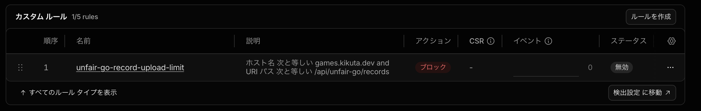

ブラウザゲーム「[反則囲碁](https://games.kikuta.dev/unfair-go/)」は、石を置くだけでなく、盤面を強引に変える反則技を使って対局できるゲームです。後から対局を振り返れるように、使った反則技や盤面の変化まで含めた棋譜を保存しています。この棋譜は端末に置くだけでなく、Cloudflare D1にも送っています。

ただ、遊ばれる量が増えるほど保存する棋譜も増えるので、どこかで受信を絞る必要が出てきます。そこで、**日本時間で1日5万局を受け付けた時点でWAFを有効にし、棋譜保存APIだけを止める**構成にしました。ゲームの画面もKataGoの実行ファイルも配信は続けたまま、棋譜の受信だけをWorkerの手前で落とします。

ゲームを止めずに棋譜の受信だけを止めるため、どういう構成にしたのかを書きます。なお、5万局は自分で決めた目安であり、Cloudflareの無料枠を必ず守れるわけではありません。本番でこの閾値に達したこともまだありません。

## 前提として押さえた無料枠

Cloudflare D1はSQLで読み書きできるデータベースで、Workersからアクセスして棋譜を保存しています。WAF（Web Application Firewall）は、指定した条件に合うHTTPリクエストを、Workerが実行される前に遮断できる仕組みです。

CloudflareのFreeプランには、次の制限があります。

| 対象 | 無料枠 |
| --- | --- |
| Workersの呼び出し | アカウント全体で1日10万回 |
| D1の読み取り | アカウント全体で1日500万行 |
| D1の書き込み | アカウント全体で1日10万行 |
| D1の保存容量 | 1データベース最大500MB |
| WAFカスタムルール | ドメインごとに最大5件 |

ここで意識しておきたいのが、日付の区切りです。WorkersとD1の日次無料枠はUTC午前0時、つまり日本時間の午前9時にリセットされます。こちらの数え方は日本時間の日付なので、Cloudflare側のリセットとは9時間ずれます。無料枠を見ながら閾値を決めるなら、どちらの日付で数えているのかを先にはっきりさせておいたほうが安全です。

今回の5万局も、Cloudflareがその数で自動的に止めてくれるわけではありません。1局をD1の1行として保存しているので、局数が増えれば書き込み行数も増えます。しかもインデックスの更新も書き込み行数に計上されますし、同じデータベースには別の機能からの書き込みもあります。5万局で受信を止めても、D1の無料枠を必ず守れるわけではない、というのが実際のところです。Workersの1日10万回は、また別の制限として残ります。

## まず端末に保存し、クラウドは後回しにする

対局が終わると、棋譜はまずブラウザのIndexedDBに保存されます。記録するのは勝敗、盤の大きさ、AIの設定、使った反則技、各手の盤面の変化などです。クラウドへ送れなくても、保存済みの対局結果とリプレイは端末に残ります。

反則技は通常の着手と違って、一度に複数の交点が変わることもあります。毎手の盤面全体を記録すると無駄が大きいので、前の盤面から**変わった交点だけ**を残す形式にしました。交点番号を36進数2桁、変更後の石の状態を1桁で表し、各手の差分として持たせています。変化の少ない局面ほどデータが小さく済みます。

送信に失敗した棋譜は未送信として残り、次に起動したときや通信が復旧したときに送り直します。クラウドへの保存が失敗しても、対局そのものと端末に残したリプレイは使えるようにしておきたかったからです。

## 送信はひとつのAPIにまとめる

クラウドへ送るときは、未送信の棋譜を最大8局まとめて、アクセス解析のイベントと一緒にPOSTします。

```text
対局終了
  → IndexedDBに棋譜を保存
  → 未送信の棋譜を最大8局まとめる
  → アクセス解析イベントも同じPOSTに入れる
  → /api/unfair-go/records
       ├─ 分析イベント → Analytics Engine
       └─ 完了棋譜     → D1（1局につき1行）
```

アクセス解析のイベントを毎回単独で送ると、その分だけWorkerが呼ばれます。棋譜の送信と相乗りさせてまとめて送ることで、呼び出し回数を抑えています。

受信するAPI側では、Origin・Referer、Content-Type、本文サイズ、棋譜のデータ構造を検証しています。IP単位のレート制限も入れました。棋譜にはプレイヤー名やメールアドレスを含めず、送信元IPも棋譜の内容としては保存していません。

## 上限に達したら、APIだけをWAFで止める

1日分の保存数を判定するために、D1のカウンター行を毎回更新するようなことはしていません。書き込みが増えてしまうからです。代わりに、棋譜テーブルの連番IDと、その日の開始時点のIDの差で保存局数を求めています。

```text
その日の保存局数 = 最新の棋譜ID − その日の開始時点のID
```

この数が5万に達すると、WorkerがCloudflareのRulesets APIを呼び、次の条件に合うリクエストをBlockするWAFカスタムルールを有効にします。

```text
(http.host eq "games.kikuta.dev"
 and http.request.uri.path eq "/api/unfair-go/records")
```

遮断するのは棋譜保存APIだけです。反則囲碁の画面もKataGoの実行ファイルも配信は続きます。翌日の日本時間0時には、Cronで同じルールを無効に戻します。



*Cloudflare管理画面で確認したWAFカスタムルール。ルールは登録済みですが、撮影時は無効で、イベントは0件でした。上限到達によって実際に発動したことを示す画面ではありません。*

Workerの内部でリクエストを拒否する方法もありますが、それだと拒否するためだけにWorkerを起動することになります。WAFを選んだのは、上限に達した後の受信をWorkerの手前で止めたかったからです。

## 止まっている間の棋譜と、403の扱い

一時的な通信エラーやサーバーエラーのときは、棋譜をIndexedDBに未送信のまま残して再送します。一方、APIがHTTP 403を返したときは、端末内だけの保存に切り替えて、クラウドへの再送対象から外しています。受信を止めている間にたまった棋譜を翌日まとめて送り直すと、その分の負荷がAPIにかかるためです。

ただし、403はWAF以外の検証失敗でも返ることがあります。ステータスコードだけでWAFが原因だと断定する作りにはしていません。WAFのルールが反映されるまでに時間差があれば、5万局を少し超えて保存される可能性も残ります。

WAFを切り替えるための設定が入っていない場合は、APIは503を返し、D1へは書き込みません。この場合も、対局には影響させていません。

## 実際の保存件数と、まだ試していないこと

本番のD1をCLIで集計したところ、**11月12日の確認時点で保存済みの棋譜は930局**でした。最も多かった日の保存件数は701局です。これはクラウド側に保存された件数で、ブラウザの中だけに残った対局は含まれません。

**WAFの5万局到達による自動ONと、翌日の自動OFFは、コードと自動テストで確認していますが、実際の本番アクセスで閾値に達したことはありません。** WAFが切り替わるまでの遅延や、Workers・D1の別の無料枠を超える可能性も残っています。

今回の設計では、棋譜のクラウド収集を止めても対局は止まらないように、保存先と受信処理を分けました。ゲームを動かすこととデータを集めることでは、止めてよい範囲が違うからです。無料枠に当たりそうな機能を足すときは、この分け方から先に決めておくと、あとで慌てずに済みます。

### Cloudflareの公式資料

- [D1の無料枠と行数による使用量](https://developers.cloudflare.com/d1/platform/pricing/)
- [D1のデータベース容量上限](https://developers.cloudflare.com/d1/platform/limits/)
- [Workers Freeの1日10万回制限](https://developers.cloudflare.com/workers/platform/limits/)
- [WAFカスタムルールの設定と無料枠](https://developers.cloudflare.com/waf/custom-rules/)
