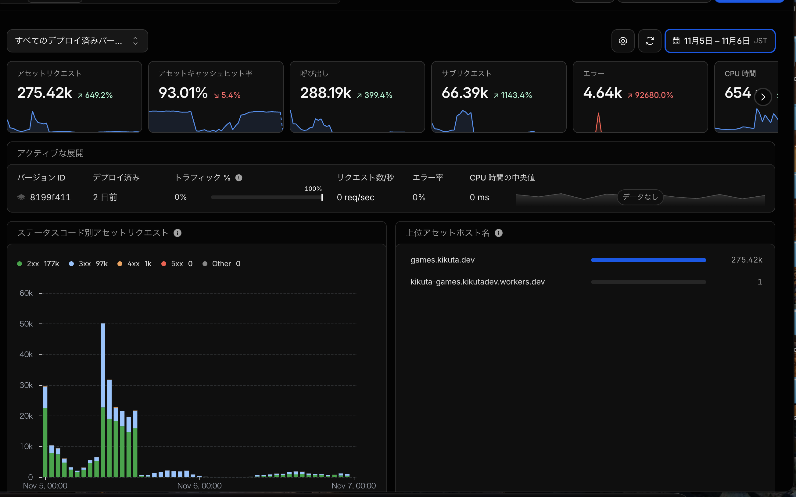

ブラウザゲーム「[GAPLINE](https://games.kikuta.dev/gapline/)」を公開した翌日、ゲームサイトのCloudflare Workersが無料枠の上限に達してしまい、**Error 1027**が発生しました。公開したばかりのゲームが遊べなくなるかもしれない。これはかなり焦りました。

どうすればゲームをまた遊べる状態にできるのか。まずは、何が上限を消費しているのかを確認しました。そこで分かったことと、そのときの対処をまとめます。

## Workersの無料枠に達して何が起きたか

Cloudflare Workersはサーバー側の処理を実行できるサービスで、ランキングやアクセス解析などのAPIに使っています。一方、ゲームのHTMLや画像、JavaScript、WASMは、そのままファイルを返せば足ります。

Cloudflare WorkersのFreeプランでは、**Workerの呼び出しはアカウント全体で1日10万回まで**という制限があります。作品ごとではなくアカウント合算です。上限はUTC午前0時、日本時間だと午前9時にリセットされます。この上限を超えると、Workerのルート設定によってはError 1027が表示されてアクセスできなくなります。

11月5日の記録では、UTC午前0時を過ぎてからゲームサイトのWorkerが**95,035回**呼び出されていました。そして、ほどなく1日10万回の上限に達してError 1027が発生しました。

後から管理画面で11月5〜6日の2日間を見ると、ゲームサイト用Workerの呼び出しは28.8万回、アセットリクエストは27.5万回、エラーは4,640件でした。2日間の合計なので、1日10万回の制限とそのまま比べることはできません。また、共通Workerの数字であってGAPLINE単体のアクセス数ではなく、エラーもすべてがError 1027ではありません。



*Cloudflare管理画面で後日確認したメトリクス。対象期間は11月5日0時〜7日0時（日本時間）。「呼び出し」「アセットリクエスト」は別の指標で、どちらもGAPLINE専用の値ではない。*

## Workerの呼び出しはどこで増えたのか

GAPLINEを含む複数のブラウザゲームを、ひとつの `kikuta-games` Workerで配信していました。そのサイトで、ゲームのHTMLや一部の実行ファイルを返す前にもWorkerを動かす設定が残っていたんです。

Cloudflare WorkersのStatic Assetsには `assets.run_worker_first` という設定項目があります。ここに対象のパスを指定すると、静的ファイルがあっても先にWorkerを呼び出します。HTMLの書き換えや認証を挟むには便利な機能ですが、ただ静的ファイルを返すだけの通信までWorkerを起動してしまうと、あっという間に無料枠を使い切ってしまいます。

Static Assetsから直接ファイルを返せば、Workerの呼び出し回数を消費せずに済みます。なのに、毎回Workerを動かしていました。

Unity WebGLのゲームは、起動時にHTMLだけでなくJavaScript、WASM、ゲームデータなど複数のファイルを一気に読み込みます。静的ファイルにWorkerを通す設定があると、1回遊ばれただけで何回もWorkerが呼ばれてしまうわけです。

ここで「AI、何やってんの！？」となりました。AIに任せていた実装が、こんなところで無料枠を消費していたとは。ちょっと悲しいです。

同じ時期にはアクセス解析の実装変更もあり、イベント受信に伴うD1の書き込みも増えていました。Workersの上限超過がGAPLINE単体のアクセスによるものとは断定できません。

## 【緊急対処】GitHub Pagesへ静的リダイレクトで一時退避する

Error 1027が出ているときは、すでにWorkerの呼び出し上限を超えている状態です。そのため、Workerのコード内にリダイレクト処理を書いてデプロイしようとしても、そもそもWorker自体が実行されないので転送できません。

そこで、Workerを介さずに動く静的なリダイレクト設定を使って、GAPLINEだけをGitHub Pagesへ一時退避させることにしました。

公開サイトの `_redirects` に次のルールを追加します。

```text
/gapline https://kikutadev.github.io/gapline-pages/ 302
/gapline/ https://kikutadev.github.io/gapline-pages/ 302
/gapline/* https://kikutadev.github.io/gapline-pages/:splat 302
```

あわせて、`wrangler.jsonc` の `assets.run_worker_first` に `!/gapline/*` を指定し、GAPLINEへのアクセスでWorkerを先に実行しないように除外しました。

302は一時的な転送です。ゲームサイトの `/gapline/` に来た人をGitHub Pagesへ転送し、元の公開URLは変えずに済みました。またゲームを遊べる状態になって、ほっとしました。

## 【復旧と恒久対策】Cloudflareへ戻して配信設定を根本から見直す

日本時間午前9時（UTC午前0時）を迎えて無料枠のリセットを確認したあと、GAPLINEの配信をCloudflareへ戻しました。ただ戻すだけでは再発してしまうので、ゲームサイト全体の配信構成を根本から整理しました。

今までリクエストのたびにWorkerでHTMLへアクセス解析用JavaScriptを注入していたんですが、ビルド時にHTMLへ組み込む方式へ変更しました。HTMLを表示するだけならWorkerを通す必要はなく、静的ファイルとして返すだけで良かったんですよね。

HTML、画像、JavaScript、WASMなどはWorkers Static Assetsから直接返し、アクセス解析やスコア保存などのAPIだけがWorkerを実行するように変更しました。

```text
ゲームのHTML・画像・JavaScript・WASM
  → Workers Static Assetsから直接配信

アクセス解析・ランキングなどのAPI
  → Workerを起動して処理
```

また、GAPLINEのWebGLファイル配信にも少し調整を入れました。Unityの圧縮済み `.unityweb` を正しくブラウザに読み込ませるため、`Content-Encoding: gzip` と形式に合わせた `Content-Type` を返す設定にしています。もともとR2経由で配信していましたが、圧縮ファイルをStatic Assetsへ移しました。

Workers Static Assetsには**1ファイル25MiB**の上限があります。当時のGAPLINEは圧縮済みデータが11.5MB、WASMが8.0MBで、どちらも上限内でした。gzip圧縮のまま配信できています。

## まとめ

結局、静的ファイルまでWorkerを起動させていた設定にミスがありました。とはいえ、複数のゲームで共有するWorkerの使用量なので、GAPLINE単体が上限超過の原因だったとまでは言えません。

Error 1027が発生したときは焦りましたが、GitHub Pagesへ退避して、またゲームを遊べるようにできたのはほっとしました。最初から止めずに済んだわけではないものの、上限に達したWorkerに頼らず復旧する方法を実際に試せたのは、いい経験でした。

### 参考リンク

- [Workers Freeの1日10万回制限とError 1027](https://developers.cloudflare.com/workers/platform/limits/)
- [Static Assetsの料金と制限](https://developers.cloudflare.com/workers/static-assets/billing-and-limitations/)
- [run_worker_firstの設定方法](https://developers.cloudflare.com/workers/static-assets/binding/)
- [リダイレクトの設定](https://developers.cloudflare.com/pages/configuration/redirects/)
