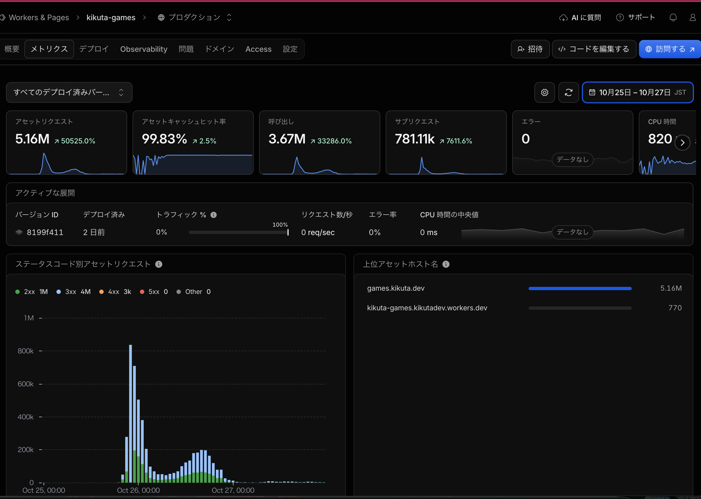
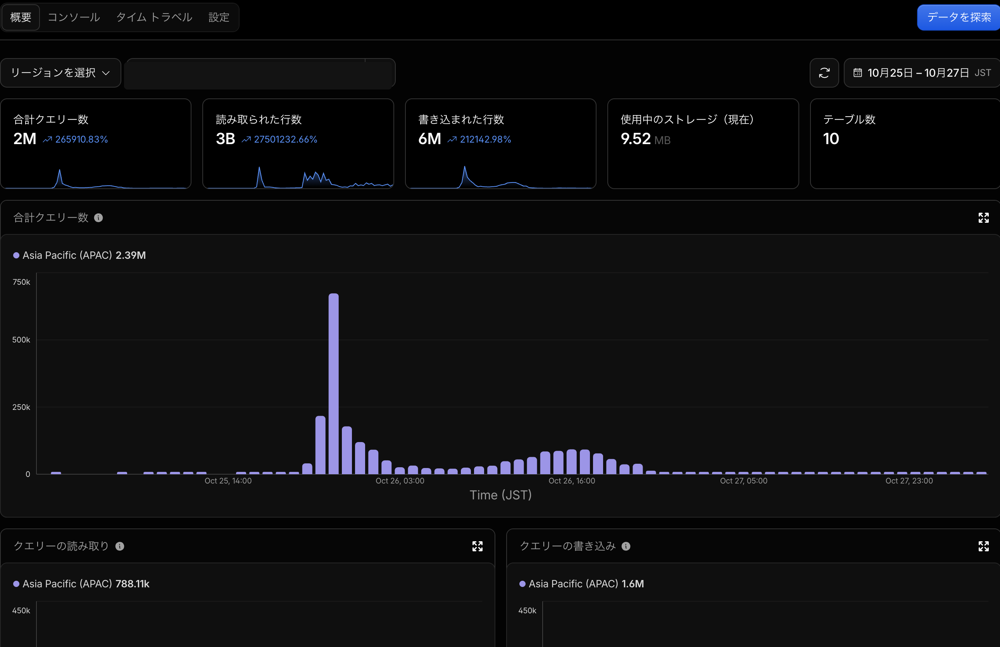

2026年10月25〜26日の2日間で、個人開発のブラウザゲーム「DUO瓦割り」が**84万回**遊ばれました。折りたたみスマホを瓦のように割って、壊した台数を競うゲームです。

https://games.kikuta.dev/duo-breaker/

アクセスが集中した25日の夜、ゲームサイト全体でCloudflare Workersが**15分間に132,360回**呼び出されました。当時のFreeプランの上限は1日10万回。たった15分で1日分を超えてしまったことになります。ゲームがたくさん遊ばれるのは嬉しいのですが、これではサイトが持たないのでは、と焦りました。

そこで、どんなリクエストがWorkerを動かしているのか、数字と設定を順に確認してみることにしました。

## Workersの呼び出し回数とD1の読み取り行数

DUO瓦割りではプレイ終了時にスコアをWorkersのAPIへ送り、D1に保存しています。世界累計やランキングを表示するときもAPIを呼びます。

10月25〜27日の3日間で、サイト全体のWorker呼び出しは**367万回**、D1の読み取りは**30億行**に達していました。どちらもDUO瓦割り単体ではなく、サイト全体の数字です。





D1の無料枠は1日500万行の読み取りと10万行の書き込みです。Workerを1回しか呼ばなくても、その中でSQLが大量の行を読めば、D1の読み取り使用量は増えます。

急場をしのぐため、Workers Paidプランに切り替えました。切り替え時の日割り請求は$1.95（税込）。でも、プランを上げても余計なWorkerの実行は減りません。設定も直すことにしました。

## 何がWorkerを動かしていたのか

まず確認したのが、`wrangler.jsonc`の`run_worker_first`です。当初の設定はこうなっていました。

```jsonc
{
  "assets": {
    "directory": "./dist",
    "binding": "ASSETS",
    "run_worker_first": true
  }
}
```

`run_worker_first: true`を指定すると、HTMLだけでなく、画像やJavaScript、CSSといった全リクエストがStatic Assetsへ届く前に必ずWorkerを経由します。

この設定は、ファイルを返す前に認証を確認したり、ログを記録したり、HTMLを書き換えたりするときには便利です。実際、ゲームサイトでもアクセス解析用のJavaScriptをHTMLに差し込むためにWorkerを使っていました。

ただ、ゲームを開くとブラウザは画像やスクリプトもまとめて取得します。HTMLを加工したいだけなのに、それらのファイルを返すたびにもWorkerが動いていたんです。

ここで「AI、何やってんの！？」となりました。AIに任せていた実装がこんな設定になっていたとは。アクセスが増えてから分かったのが、ちょっと悲しいです。

そこで、Workerを通過させるパスを必要なものだけに限定しました。主な設定内容は次の通りです。

```jsonc
{
  "assets": {
    "directory": "./dist",
    "binding": "ASSETS",
    "run_worker_first": [
      "/",
      "/*/",
      "/*.html",
      "/api/*"
    ]
  }
}
```

HTMLやAPIのリクエストはWorkerを通し、ゲーム内の画像・JavaScript・CSSはStatic Assetsから直接返すようにしました。

途中、`/duo-breaker/*`という指定を残してしまいました。これだと画像やJavaScriptもWorkerを通ってしまいます。この指定も外しました。

## D1はなぜ30億行も読み取っていたのか

Workerの設定を直したところで、D1の読み取り行数も見直しました。

DUO瓦割りには、プレイが終わるたびに破壊台数を加算する`duo_breaker_totals`というテーブルがあります。もともとは、このテーブルを見るだけで世界累計を取得できる作りでした。

ところが後から「1,000台以上の異常値を通常の世界累計から除外する」仕様を追加したときに、表示のたびにプレイ履歴全体を読み直すSQLを書いてしまっていました。

```sql
SELECT t.broken_phones - (
  SELECT COALESCE(SUM(r.destroyed), 0)
  FROM duo_breaker_runs r
  WHERE r.destroyed >= 1000
) AS brokenPhones
FROM duo_breaker_totals t
WHERE t.id = 1;
```

最終的に返す値は世界累計の数値1つだけですが、その都度`duo_breaker_runs`テーブルの全履歴をスキャンします。その結果、**わずか1回の取得リクエストで86万行**を読み取る状態になっていました。数字を見たときは、さすがに目を疑いました。世界累計をひとつ表示するだけなのに。

そこで、除外する台数も集計テーブル側にあらかじめ保持する形へ改修しました。`duo_breaker_totals`テーブルに`bot_phones`カラムを追加し、プレイ結果が確定した段階で加算するようにしています。過去の記録は移行スクリプトで一度だけ集計して反映しました。

修正後は次のSQLで世界累計を取得できます。

```sql
SELECT broken_phones - bot_phones AS brokenPhones,
       completed_plays AS plays
FROM duo_breaker_totals
WHERE id = 1;
```

表示のたびに履歴を読み直す処理がなくなり、86万行だった読み取りは**162行**になりました。

ランキングも全プレイ履歴から毎回自己ベストを計算するのをやめました。名前を登録したプレイヤーのベスト記録は、別テーブルに保存しています。

## 同じ数字を何度もD1から読まないようにする

同じ世界累計やランキングを表示するたびに、D1へ問い合わせるのも無駄でした。

世界累計のGET APIは120秒、ランキングは600秒キャッシュするように変更しました。その間は同じ数字を表示するためにD1へ繰り返し問い合わせずに済みます。プレイ直後の本人の記録には、古いキャッシュ結果を返さないようにしています。

## まとめ

アクセスが急増して初めて、静的ファイルまでWorkerを通す設定と、世界累計を表示するたびに履歴を読み直すSQLのミスに気付きました。

それでも、対応しながらゲームを動かし続けられたのは、ほっとしました。公開して終わりではなく、実際に遊ばれたときの運用まで経験できたのは良かったです。

関連する公式資料は[Static Assetsと`run_worker_first`の設定](https://developers.cloudflare.com/workers/static-assets/binding/)と[D1の料金・使用量](https://developers.cloudflare.com/d1/platform/pricing/)です。
