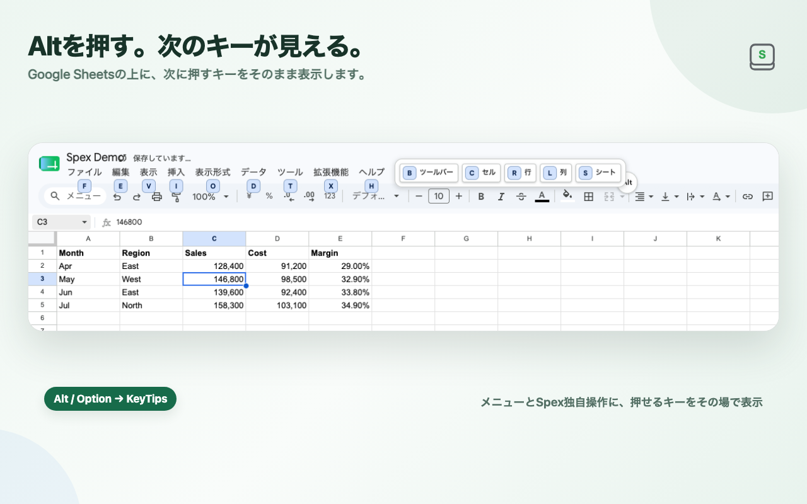
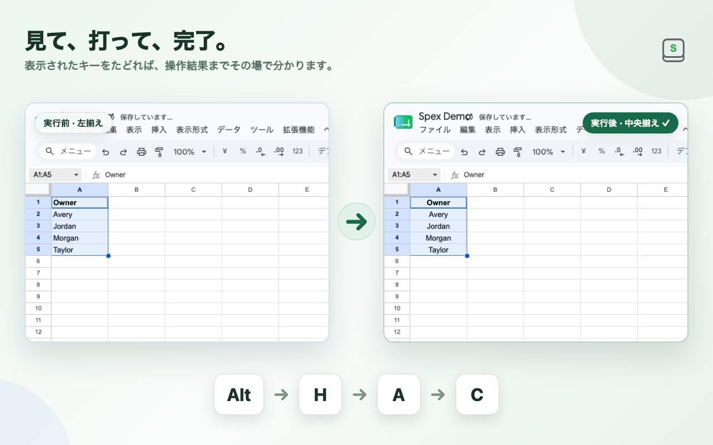
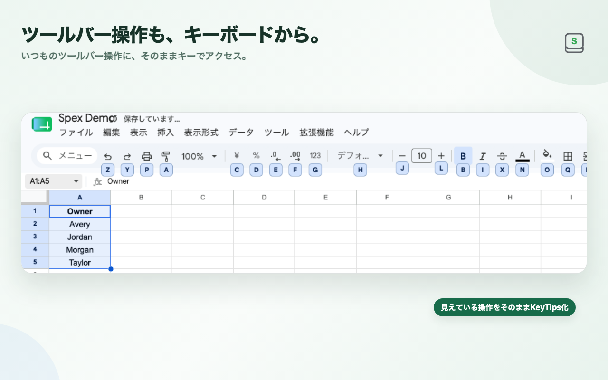

Google SheetsでExcelのようなAlt / Option起点の段階的ショートカットを使えるChrome拡張、**Spex** を作りました。



Spexでは、Alt / Optionを押すとGoogle Sheets上にKeyTipsを表示し、画面に出たキーを順番に押して操作します。

https://spex.kikuta.dev/ja

https://chromewebstore.google.com/detail/gahnolkboklnjhnaahjdkingoejbepcc

一見すると、実装は単純に見えます。

1. `keydown` を監視する
2. 入力されたキー列を判定する
3. 対応するGoogle Sheetsのボタンを探す
4. `click()` する

しかし、実際に日常利用できるChrome拡張として作り込むと、難しかったのはショートカット表そのものではありませんでした。

難しかったのは、**自分では制御できない巨大なWebアプリの上に、壊れにくい操作レイヤーをどう載せるか**です。

この記事では、Spexを作る中で最終的に採用した設計を、特に次の観点から整理します。

- キーマップとGoogle SheetsのDOMを分離する
- コマンドごとに実行能力を明示する
- 実行方式を一つに固定しない
- fallbackを「失敗したら何でも試す」にしない
- 「イベントを送った」ではなく、実際の結果を観測する
- locatorが0件・複数件・disabledなら推測して進まない
- セル編集やIMEからキーボードを奪わない
- 実Google SheetsでE2Eを行う

## 「selectorを集めれば完成」ではなかった

最初に問題になるのは、Google SheetsのDOMです。

たとえば「太字」を実行するだけなら、現時点のGoogle Sheetsには対応するtoolbar controlがあります。Chrome拡張からその要素を探し、クリックすればよさそうに見えます。

しかし、実際にはそれだけでは十分ではありません。

- selectorが将来変わる可能性がある
- メニュー項目は開いているときだけ操作可能なことがある
- 同じ文言の候補が複数存在することがある
- UI languageによってメニュー文字列が変わる
- controlが存在してもdisabledの場合がある
- clickを送れてもGoogle Sheets側で処理されない場合がある
- 非同期レンダリングで要素が少し遅れて出現する
- 操作後のfocus ownerが変わる

さらに、Google Sheetsの操作には性質の違うものがあります。

- 太字のように `aria-pressed` の変化を観測できるもの
- 行追加のようにsheet構造の変化を見るもの
- ダイアログが開いたことを確認するもの
- clipboard系のようにブラウザ制約上、完全な結果確認が難しいもの
- Google Sheetsに対応概念そのものがないもの

そこで、Spexでは「キー列 → selector」という設計をやめ、間に複数の境界を置きました。

## 1. Shortcut MachineはGoogle SheetsのDOMを知らない

現在のSpexは、概念的には次のような構造です。

```text
Keyboard Event
    ↓
Shortcut Machine
    ↓
Semantic Command
    ↓
Execution Capability / Strategy
    ↓
GoogleSheetsAdapter
    ↓
Google Sheets
```

Shortcut Machineが扱うのは、例えば次のようなcommandです。

```text
ToggleBold
InsertRowAbove
FreezeFirstRow
OpenKeyboardShortcuts
```

ここにはselectorや日本語メニュー名を持たせません。

つまり、Core側は次のことだけを知っています。

- 現在どのキーsequenceにいるか
- 次に押せるキーは何か
- commandが確定したか
- Escape等でキャンセルされたか

一方で、Google Sheets固有のselector、menu label、dialog、toolbar stateなどはAdapter側に閉じ込めます。

実際のAdapter interfaceもかなり小さくしています。

```ts
export interface GoogleSheetsAdapter {
  canHandle(command: CommandId): boolean;
  execute(command: CommandId): Promise<CommandExecutionResult>;
}
```

この分離で重要なのは、**キーマップの変更理由とGoogle Sheets側のUI変更理由を分けること**です。

たとえば「Excel準拠のキー列を変えたい」ときにGoogle SheetsのDOM知識まで触る必要はありません。逆にGoogle Sheetsのtoolbar構造が変わっても、Shortcut Machineの状態遷移を変更する必要はありません。



## 2. 「対応しているはず」をやめて、Execution Capabilityを全件定義する

次に問題になったのが、**キーマップに存在するcommandと、本当に実行可能なcommandのズレ**です。

ショートカット一覧にキーを追加すること自体は簡単です。しかし、キーが表示されるのに実際には実行手段がない状態はUXとしてかなり悪いです。

そこでSpexでは、semantic commandごとに実行能力を明示的に分類しています。

```ts
export type ExecutionCapabilityKind =
  | "dual"
  | "internal-api"
  | "ui"
  | "browser"
  | "passive"
  | "unsupported"
  | "dedicated";
```

そして、すべての `CommandId` に対してclassificationを持つ `Record` を作っています。

```ts
export const EXECUTION_CAPABILITIES = {
  [CommandId.Undo]: "dual",
  [CommandId.InsertRowAbove]: "dual",
  [CommandId.ToggleBold]: "dual",
  [CommandId.OpenMenuSearch]: "ui",
  [CommandId.CreateNewSpreadsheet]: "browser",
  [CommandId.OpenFormatCells]: "unsupported",
  // ...
} as const satisfies Record<CommandId, ExecutionCapabilityKind>;
```

ポイントは `satisfies Record<CommandId, ...>` です。

新しいcommandを追加したのに実行能力の分類を忘れると、runtimeでなんとなく `unsupported` になるのではなく、typecheckで漏れが見つかります。

Chrome拡張のように、対応範囲が増え続ける製品では、**「未実装を暗黙のdefaultに落とさない」**ことがかなり効きました。

また、この情報をKeyTips側でも利用することで、「実行不能なshortcutを画面上に出してしまう」問題を減らせます。

## 3. 実行方式を一つに決めない

Google Sheetsの操作は、すべて同じ方法で安定して実行できるわけではありません。

Spexでは大きく、次のような実行経路を持っています。

- Google Sheetsページ側のsemanticなactionを使える経路
- visible UIを操作する経路
- browser actionとして処理する経路
- 専用runtimeへ渡す経路

そして、同じcommandでも複数経路を持てるものを `dual` としています。

```ts
const capability = getExecutionCapability(command);

return executeWithStrategy(getExecutionMode(), {
  ...(capability === "dual" || capability === "internal-api"
    ? { internalApi: () => internalAdapter.execute(command) }
    : {}),
  ...(capability === "dual" || capability === "ui"
    ? { ui: () => uiAdapter.execute(command) }
    : {}),
});
```

ここで大事なのは、「内部actionが使えるから常に内部action」「DOMがあるから常にDOM」というように、実行方式を宗教化しないことでした。

操作ごとに、安定して実行でき、なおかつ結果を確認できる経路を選びます。

## 4. fallbackは保守的にする

複数の実行経路を持つと、次に考えたくなるのはfallbackです。

```text
internalで失敗
→ UIで再実行
```

一見よさそうですが、これは破壊的なcommandでは危険です。

たとえば行追加を考えます。

1. internal actionを呼ぶ
2. timeoutする
3. 実はGoogle Sheets側では行追加が完了している
4. 「失敗した」と判断してUI経路でもう一度行追加する

これでは1回の操作で2行増える可能性があります。

そのためSpexのauto fallbackは、**失敗結果が明示的に `retryable: true` の場合だけ**許可しています。

```ts
function shouldFallback(result: ExecutionAttemptResult): boolean {
  return (
    (result.status === "failed" || result.status === "unsupported") &&
    result.retryable === true
  );
}
```

「失敗したから次を試す」のではなく、

> この失敗は副作用が発生していないと判断できるので、別経路を試してよい

というcontractにしています。

特に外部アプリを操作するintegrationでは、**timeout = 未実行**とは限りません。

これは実装してみてかなり重要だったポイントです。

## 5. 「dispatch成功」をcommand成功にしない

Spexで最も重視した設計の一つが、実行結果のverificationです。

たとえば太字なら、単にbuttonへeventを送れたことは成功条件にしていません。

実際に `aria-pressed` が変わったことまで待ちます。

```ts
const before = element.getAttribute("aria-pressed");

await activateControlAction(...);

const changed = await waitForCondition(
  doc,
  () => {
    const after = element.getAttribute("aria-pressed");
    return after !== before;
  },
  OBSERVATION_TIMEOUT_MS,
);

return changed
  ? { status: "executed" }
  : { status: "failed", reason: verificationFailed };
```

行追加なら、active sheetのscroll extentが増えたかを見ます。

シート追加なら、sheet tabの数が1つ増えたかを見ます。

chart追加なら、chart objectの数が増えたかを見ます。

dialog系commandなら、対象dialogが実際にvisibleになったことを確認します。

つまり、できるだけ次の形にします。

```text
Action
  ↓
Observable Result
  ↓
executed / failed
```

これにより、「clickは通ったので成功」という偽陽性を減らせます。

一方で、結果を完全には検証できないcommandも存在します。その場合は `executed` と同じ意味にせず、`invoked` のように区別しています。

## 6. locatorが0件・複数件なら、推測してクリックしない

Google Sheetsのmenu itemを探す処理では、候補が1件だけ見つかることを重視しています。

```ts
function findVisibleMenuItem(...): HTMLElement | null {
  const matches = findVisibleMenuItems(...);
  return matches.length === 1 ? matches[0] : null;
}
```

0件なら「見つからない」。

2件以上なら「曖昧」です。

「最初の1件をクリックする」という実装は簡単ですが、host UIが変わった瞬間に別のcommandを実行するリスクがあります。

Spexでは、次のような状態を分けています。

- menu item not found
- menu item ambiguous
- menu item disabled
- submenu open failed
- verification failed

つまり、**壊れたときに間違った操作を続けるより、止まることを選ぶ**設計です。

Chrome拡張で第三者サービスを操作する場合、「壊れない」ことは現実的には保証できません。

それよりも、

> 壊れたときに、どのように壊れるかを制御する

方が重要だと感じています。

## 7. Google Sheetsの表示言語をSpexの言語設定と混ぜない

メニュー操作では、文字列による探索が必要なケースもあります。

ここで別の問題になるのがlocaleです。

Spex自身のUI言語が日本語だからといって、Google Sheetsも日本語とは限りません。

逆もあります。

そのため、

- SpexのUIを何語で表示するか
- hostであるGoogle Sheetsが何語で表示されているか

は別の問題として扱う必要があります。

自分のextension localeでhost menu labelを決めてしまうと、cross-locale環境で壊れます。

第三者Webアプリ上に機能を載せるときは、**自分のlocaleとhost localeを同じものとして扱わない**、というのも地味ですが重要な設計でした。

## 8. Keyboard-firstだからこそ、キーボードを奪わない

Spexはキーボード操作を増やす拡張ですが、だからこそ一番避けたいのが、通常の入力を壊すことです。

特に日本語環境ではIMEがあります。

単純に `keydown` だけを見ていると、次のようなイベントとの境界が問題になります。

- composition
- beforeinput
- keypress
- compositionend
- セル編集
- 数式編集

Spexでは、Alt / Optionを押したからといって常に独自sequenceへ入るわけではありません。

通常typing、セル編集、formula editing、IME compositionを優先し、Spexが明示的にshortcut interactionを所有している場面だけ必要なeventを処理します。

これはプロダクトのUXとしても重要でした。

Keyboard-firstなツールは、shortcutを増やすことより、**元アプリのkeyboard ownershipを壊さないこと**の方が難しい場合があります。

## 9. 実Google SheetsでE2Eする

unit testだけでは、ここまでの問題のかなりの部分を捕まえられません。

DOM fixture上では動いても、実Google Sheetsでは、

- menuが遅れて出る
- focusが別elementへ移る
- popupが残る
- virtualized UIの状態が違う
- composition eventの順序が違う

といったことが起きます。

そのためSpexでは、実際のGoogle Sheetsを開くE2Eを重要視しています。

たとえば次のようなことを確認します。

- Alt / OptionでKeyTipsが表示される
- shortcut実行後、Google Sheets上のobservable stateが変わる
- command完了後に次のsequenceを続けて実行できる
- セル編集中にはSpexが入力を奪わない
- IME/composition後にもshortcut stateが壊れない
- 0件 / 1件 / 複数件 / disabled / delayed / detachedのlocator条件を扱える

fixture testとreal-host E2Eは役割が違います。

fixtureでは壊れ方を細かく再現し、real-host E2EではGoogle Sheetsとの契約そのものがまだ成立しているかを確認します。

## KeyTipsも「shortcut一覧」ではなく状態表示にする

ユーザー側の話に戻ると、Spexではshortcutを大量に覚えることを前提にしていません。

Alt / Optionを押すと、現在のsequenceで次に入力できるキーを画面上に表示します。



最初の状態と、Format系menuへ進んだ状態では、表示される候補も変わります。

つまりKeyTipsはstaticなcheat sheetではなく、Shortcut Machineの現在状態を可視化するUIです。

実装上も、

```text
current shortcut state
    ↓
next available transitions
    ↓
KeyTips
```

という関係にしたことで、表示と実行のズレを減らしやすくなりました。

## まとめ: 第三者Webアプリ拡張では「壊れない」より「壊れ方を設計する」

Spexを作っていて、最終的に一番大きかった学びはこれでした。

**第三者Webアプリの上に載るChrome拡張では、DOM変更を完全に避けることはできない。だから、壊れ方を設計する。**

具体的には、次のような方針です。

1. Shortcut Machineからhost DOM知識を分離する
2. semantic commandごとに実行能力を明示する
3. 実行経路をcommandに合わせて選ぶ
4. fallbackはretry safeな場合だけ行う
5. event dispatchではなくobservable resultを確認する
6. locatorが曖昧なら推測して実行しない
7. input / IMEのownershipを尊重する
8. fixtureと実Google Sheets E2Eの両方を持つ

単にselectorを頑丈にするだけでは、外部Webアプリとのintegration全体は頑丈になりません。

**Coreとhost integrationの境界、実行結果のcontract、失敗時の挙動まで含めて設計する**ことで、ようやく保守できる形に近づいたと感じています。

今回作ったSpexはChrome Web Storeで公開しています。

https://chromewebstore.google.com/detail/gahnolkboklnjhnaahjdkingoejbepcc

12秒程度で操作感が分かるデモも公開しています。

https://spex.kikuta.dev/ja

ExcelとGoogle Sheetsを行き来している方や、Sheetsをキーボード中心で使いたい方には、ぜひ試してもらえればと思います。

また、Chrome拡張から複雑な第三者Webアプリを操作している方がいれば、locator driftや実行結果verificationをどのように扱っているかも知りたいです。
